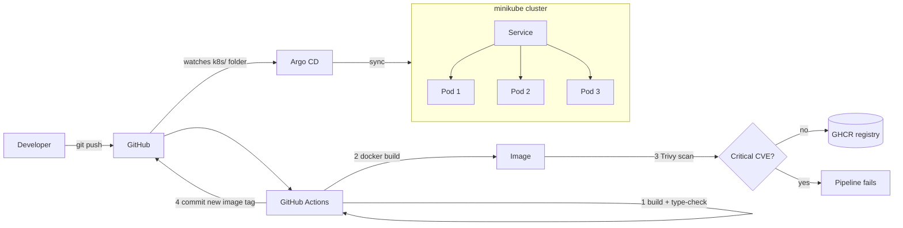

# DevOps Control Room

A Next.js app whose whole purpose is to **show DevOps and Kubernetes working**. The UI is a live
dashboard: which pod answers each request, how traffic is spread across replicas, what happens
when you crash a pod, and which Git commit the CI/CD pipeline deployed.

No Prometheus, no Grafana, no cloud account. Everything runs free on your laptop with minikube.

## Architecture



## What it demonstrates

| Concept | Where to look |
|---|---|
| Multi-stage, non-root Docker image | `app/Dockerfile` |
| Deployment, Service, ConfigMap | `k8s/` |
| Liveness vs readiness vs startup probes | `k8s/deployment.yaml`, `app/src/app/api/health`, `api/ready` |
| Zero-downtime rolling updates | `strategy` in `k8s/deployment.yaml` |
| Self-healing | "Crash a pod" button in the UI |
| Load balancing | bars in the UI |
| Config outside the image | `k8s/configmap.yaml` (shown in the UI) |
| Downward API (pod knows its name, node, IP) | `env` in `k8s/deployment.yaml` |
| Resource requests and limits, security context | `k8s/deployment.yaml` |
| PodDisruptionBudget | `k8s/pdb.yaml` |
| CI with security gate (Trivy) | `.github/workflows/ci-cd.yml` |
| GitOps with Argo CD | `argocd/application.yaml` |
| Kustomize image tag promotion | `k8s/kustomization.yaml` |

## Prerequisites

Install: **Node.js 20+**, **Docker Desktop**, **minikube**, **kubectl**, **git**.
Check with `node -v`, `docker version`, `minikube version`, `kubectl version --client`.

## Step 1: run it locally (no Docker, no Kubernetes)

```powershell
cd app
npm install
npm run dev
```

Open http://localhost:3000. You will see a yellow note that it is running outside Kubernetes.

## Step 2: build the Docker image

From the project root:

```powershell
docker build -t nextjs-devops:local --build-arg GIT_SHA=local app
```

## Step 3: deploy to minikube

```powershell
minikube start --cpus=2 --memory=3072
minikube image load nextjs-devops:local
kubectl apply -k k8s
kubectl -n devops-demo rollout status deploy/nextjs-devops
kubectl -n devops-demo get pods
minikube service nextjs-devops -n devops-demo
```

The last command opens the dashboard in your browser (keep that terminal open).
You should see 3 pods in `kubectl get pods` and 3 bars filling up in the UI.

## Step 4: the demos (this is what you show in an interview)

**Self-healing.** Click **Crash a pod** in the UI. In a second terminal run
`kubectl -n devops-demo get pods -w`. One pod's `RESTARTS` goes to 1 and the event log says
Kubernetes restarted it. Meanwhile the page kept working because the other pods answered.

**Readiness.** Click **Toggle readiness of a pod**. That pod stays `Running` but its `READY`
column drops to `0/1`, and its bar stops growing. Liveness restarts a container, readiness only
removes it from traffic. Click again until every pod is ready.

**Rolling update with zero downtime.** Build a second version and roll it out:

```powershell
docker build -t nextjs-devops:v2 --build-arg APP_VERSION=v2 --build-arg GIT_SHA=v2 app
minikube image load nextjs-devops:v2
kubectl -n devops-demo set image deploy/nextjs-devops web=nextjs-devops:v2
kubectl -n devops-demo rollout status deploy/nextjs-devops
```

The UI switches from `local` to `v2` pod by pod with no failed requests.

**Rollback.**

```powershell
kubectl -n devops-demo rollout undo deploy/nextjs-devops
```

**Scaling.**

```powershell
kubectl -n devops-demo scale deploy/nextjs-devops --replicas=5
```

**Config change without rebuilding.** Edit `WELCOME_MESSAGE` in `k8s/configmap.yaml`, then:

```powershell
kubectl apply -k k8s
kubectl -n devops-demo rollout restart deploy/nextjs-devops
```

**Useful debugging commands** (also great to know for interviews):

```powershell
kubectl -n devops-demo describe pod <pod-name>
kubectl -n devops-demo logs <pod-name>
kubectl -n devops-demo get events --sort-by=.lastTimestamp
kubectl -n devops-demo get endpoints nextjs-devops
```

## Step 5: CI/CD with GitHub Actions

1. Create a **public** GitHub repo called `nextjs-devops` and push this project to it.
2. In the repo go to **Settings > Actions > General > Workflow permissions** and select
   **Read and write permissions** (the pipeline commits the new image tag).
3. Push to `main`. The pipeline in `.github/workflows/ci-cd.yml` runs:
   build and type-check, Docker build, Trivy scan, push to GHCR, then it commits the new image
   tag into `k8s/kustomization.yaml`.
4. After the first run, go to your GitHub profile > **Packages** > `nextjs-devops` > **Package
   settings** and set visibility to **Public**, so the cluster can pull it without credentials.

Pull requests run build, Docker build and scan, but never push or deploy.

## Step 6 (optional): GitOps with Argo CD

Use more memory for this step: `minikube start --cpus=2 --memory=4096`.

```powershell
kubectl create namespace argocd
kubectl apply -n argocd -f https://raw.githubusercontent.com/argoproj/argo-cd/stable/manifests/install.yaml
kubectl -n argocd rollout status deploy/argocd-server
kubectl -n argocd port-forward svc/argocd-server 8080:443
```

Get the admin password (PowerShell):

```powershell
$p = kubectl -n argocd get secret argocd-initial-admin-secret -o jsonpath="{.data.password}"
[Text.Encoding]::UTF8.GetString([Convert]::FromBase64String($p))
```

Open https://localhost:8080 (user `admin`). Edit `argocd/application.yaml`, replace
`REPLACE_ME_GITHUB_USER` with your GitHub username, then:

```powershell
kubectl apply -f argocd/application.yaml
```

From now on, a `git push` changes the cluster. Nobody runs `kubectl apply`. If someone edits the
Deployment by hand, Argo CD reverts it (`selfHeal`).

## Optional: autoscaling

```powershell
minikube addons enable metrics-server
kubectl apply -f k8s/optional/hpa.yaml
```

## Clean up

```powershell
kubectl delete -k k8s
minikube stop
```

## Troubleshooting

| Problem | Fix |
|---|---|
| Pods stuck in `ErrImagePull` / `ImagePullBackOff` | Run `minikube image load nextjs-devops:local` again, then `kubectl -n devops-demo rollout restart deploy/nextjs-devops` |
| `minikube start` fails | Make sure Docker Desktop is running. Try `minikube delete` then start again |
| UI shows only one pod | The browser may reuse a connection. Hard refresh, or reset the counts. The API already sends `Connection: close` |
| Crash button says "blocked" | `ENABLE_CHAOS` is not `true` in `k8s/configmap.yaml` |
| Pipeline fails at Trivy | A fixable CRITICAL vulnerability was found. Update the dependency in `app/package.json` |
| Pipeline cannot push the manifest commit | Enable "Read and write permissions" for workflows (Step 5) |

## Interview talking points

- **Why probes?** Liveness restarts a hung container. Readiness keeps traffic away from a pod that
  is up but not ready. Startup gives slow boots time without loosening liveness.
- **Why `maxUnavailable: 0`?** A new pod must become ready before an old one is removed, so a
  deploy never reduces capacity.
- **Why scan before push?** A vulnerable image never reaches the registry.
- **Why tag images with the commit SHA, not `latest`?** The tag tells you exactly what is running
  and makes rollback and audits possible.
- **Why GitOps?** Git is the single source of truth, every change is reviewed and reversible,
  and drift is corrected automatically.
- **Honest limits:** this is a demo. The chaos endpoints must never exist in production, a real
  setup would add ingress with TLS, secrets management, and monitoring.


  

